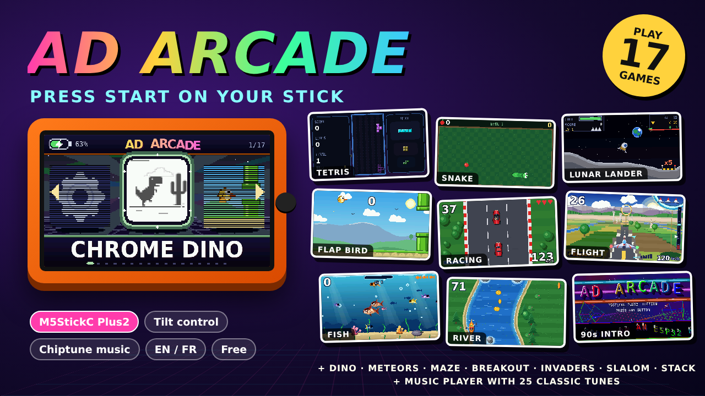
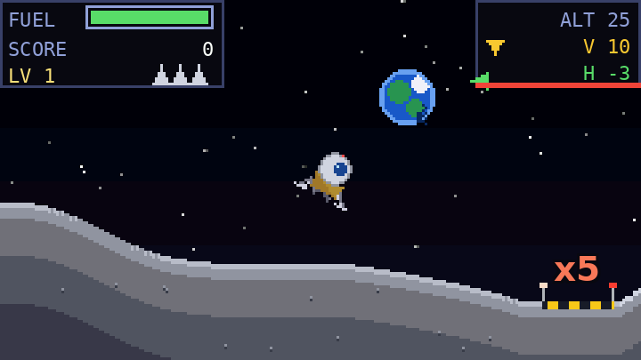
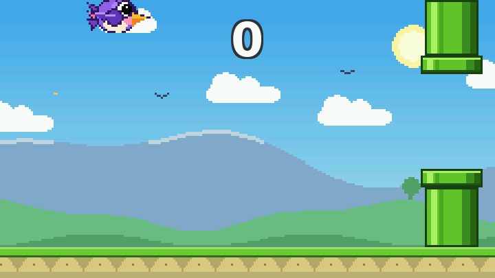
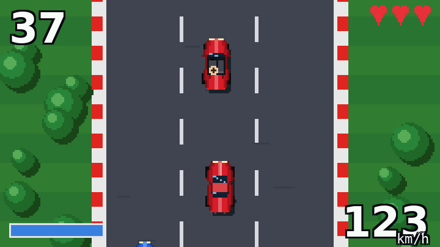
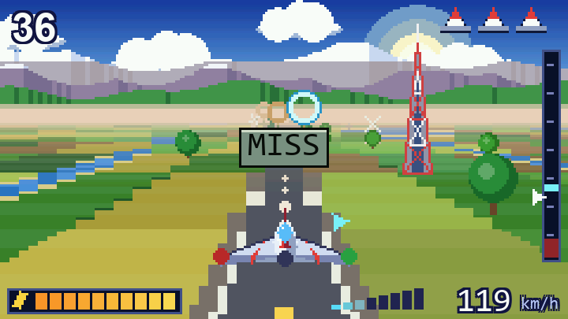
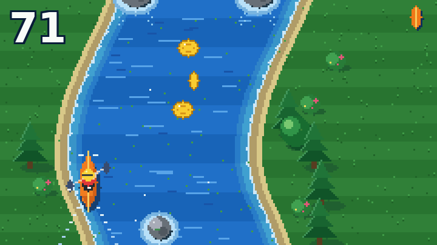

<p align="center"></p>

# AD Arcade for the M5StickC Plus2

**English** | [Français](#français)

A retro handheld game console firmware for the **M5StickC Plus2**. Boot it, enjoy a 90s style intro, pick a game in an animated menu and play. 15 games, medals, a music player and a settings page with themes, all in one `.bin`.

<p align="center"></p>

## Games

| | | |
|---|---|---|
|  **Tetris** |  **Snake** |  **Lunar Lander** |
|  **Flap Bird** |  **Racing** |  **Flight** |
|  **Fish** |  **River** | |

Also included: **Chrome Dino, Meteors, Maze, Breakout, Invaders, Slalom, Stack**, plus a **Music player** with 25 public domain tunes and a **Settings** page.

## Features

- Tilt controls using the built-in motion sensor. It detects whether you hold the stick flat or upright and adapts
- Quiet chiptune background music in every game (can be turned off)
- High scores saved for each game
- Animated menu with battery indicator
- Trophies (bronze, silver, gold for each game)
- Settings: theme, brightness, sound, game music, sleep time, sensor calibration, language
- English and French
- Version number shown in Settings (top right)

## Controls

| Button | Action |
|---|---|
| **A** | Select / main action |
| **B** | Secondary action / next |
| **PWR** | Pause (previous item in the menu) |
| **Hold PWR 1.5 s** or **hold A + B 1.2 s** | Back to the menu |
| **Tilt** | Steer in the games that use it |

## Install

**Easiest:** open [M5Burner](https://burner.m5stack.com/SKKL8X), pick AD Arcade and click Burn.

**Manual:** download `AD-Arcade-M5StickCPlus2-v1.4.bin` from the [Releases](../../releases) page and flash it at address `0x0`:

```
esptool.py --chip esp32 --port <your port> write_flash 0x0 AD-Arcade-M5StickCPlus2-v1.4.bin
```
for example, port `COM3`
## Build from source

Requires [PlatformIO](https://platformio.org/).

```
pio run -e m5stickc-plus2
```

The result is `AD-Arcade-M5StickCPlus2.bin`, a single image to flash at `0x0`. Built with M5Unified 0.2.7 and M5GFX 0.2.9.

## Feedback

Found a bug or have an idea for a new mini game? Open an [issue](../../issues). I have only tested on my own M5StickC Plus2, so reports are very welcome.

## License

Code under the [MIT license](LICENSE). The tunes in the music player are public domain, and the games and music loops are original.

---

# Français

Un firmware de console de jeux rétro pour le **M5StickC Plus2**. Tu l'allumes, tu regardes l'intro façon années 90, tu choisis un jeu dans un menu animé et tu joues. 15 jeux, des médailles, un lecteur de musique et des réglages avec thèmes, dans un seul `.bin`.

## Jeux

Tetris, Snake, Lunar Lander, Flap Bird, Racing, Flight, Fish, River, Chrome Dino, Meteors, Maze, Breakout, Invaders, Slalom, Stack, plus un **lecteur de musique** avec 25 airs du domaine public et une page de **réglages**.

## Fonctionnalités

- Contrôle par inclinaison avec le capteur de mouvement intégré. Il détecte si tu tiens le stick à plat ou debout et s'adapte
- Petite musique chiptune dans chaque jeu (désactivable)
- High scores sauvegardés pour chaque jeu
- Menu animé avec indicateur de batterie
- Réglages : luminosité, son, musique des jeux, veille, calibrage du capteur, langue
- Français et anglais
- Numéro de version affiché dans les réglages (en haut à droite)

## Commandes

| Bouton | Action |
|---|---|
| **A** | Valider / action principale |
| **B** | Action secondaire / suivant |
| **PWR** | Pause (élément précédent dans le menu) |
| **PWR maintenu 1,5 s** ou **A + B maintenus 1,2 s** | Retour au menu |
| **Inclinaison** | Diriger dans les jeux qui l'utilisent |

## Installation

**Le plus simple :** ouvre [M5Burner](https://burner.m5stack.com/SKKL8X), choisis AD Arcade et clique sur Burn.

**Manuel :** télécharge `AD-Arcade-M5StickCPlus2-v1.4.bin` dans les [Releases](../../releases) et flashe-le à l'adresse `0x0` (commande ci-dessus).

## Retours

Un bug ou une idée de mini jeu ? Ouvre une [issue](../../issues). Je n'ai testé que sur mon propre M5StickC Plus2, donc tous les retours sont les bienvenus.
