<p align="center"></p>

# AD Arcade

A retro handheld game console firmware for the **M5StickC Plus2** (also built for the M5StickC Plus, M5StickS3 and M5Cardputer). Boot it, enjoy a 90s style intro, pick a game in the animated menu and play. **18 games**, including a full pixel-art adventure, a tower defense, a pinball, medals, a daily challenge, a 2-player mode, stats, skins and a music player, all in one `.bin`.

<p align="center">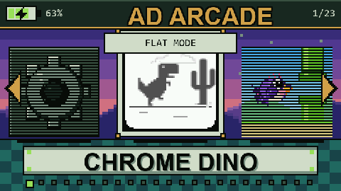</p>

## New in v1.8: Legend of Emberwood

<p align="center">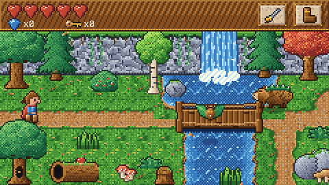</p>

A top-down pixel-art adventure with an original hero, Kiri. Talk to the villagers, get a sword, cross the forest (river, waterfall, clearing, ruins), explore the torch-lit crypt and defeat the **Ember Golem**, a 3-phase boss.

| | | |
|---|---|---|
| 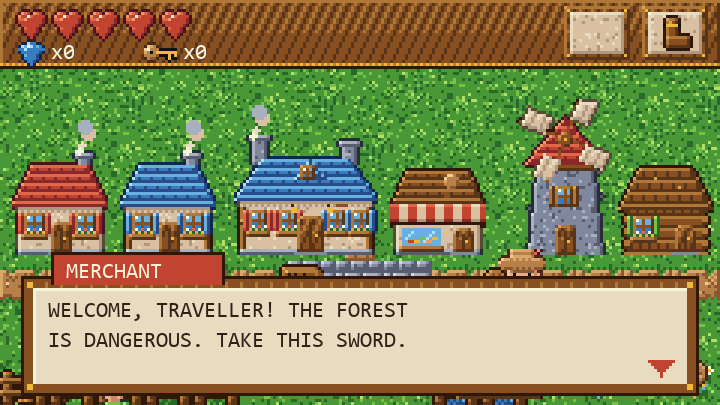 | 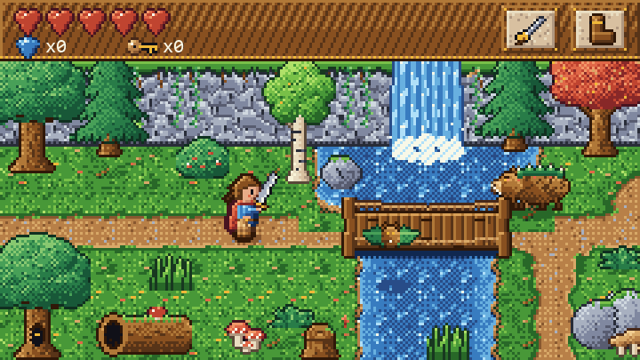 | 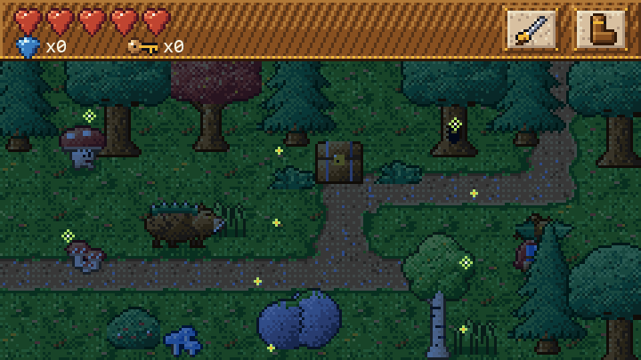 |
| 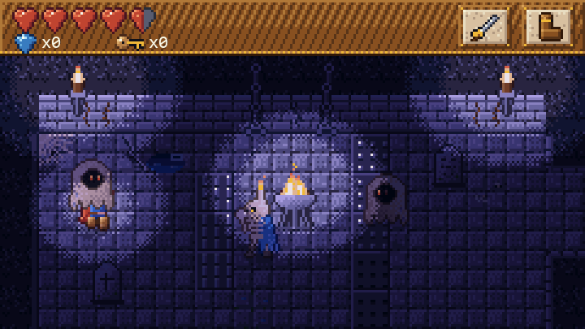 | 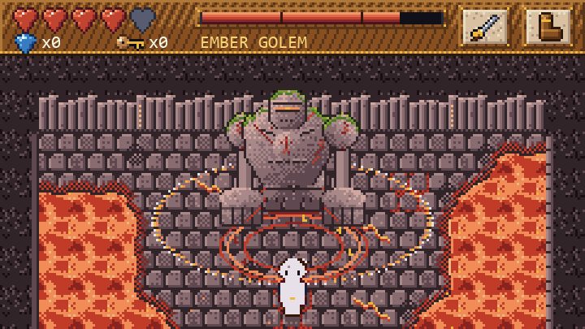 | 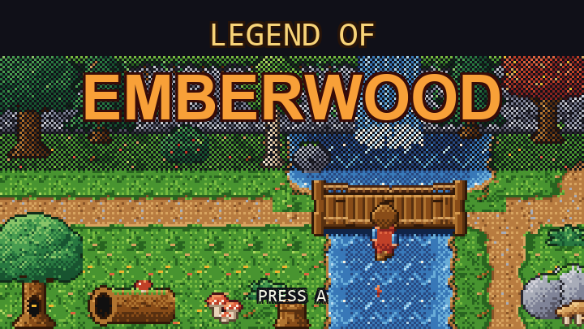 |

- Tilt to walk, **A** = sword / talk / open, **B** = roll, **PWR** = pause
- Hearts, gems, keys, chests, breakable urns, cuttable grass
- Day/night cycle with fireflies, dynamic torch lighting in the crypt
- Original music, medals and a final score, auto-save (Continue / New game)

## New in v1.9: Pocket Siege

<p align="center">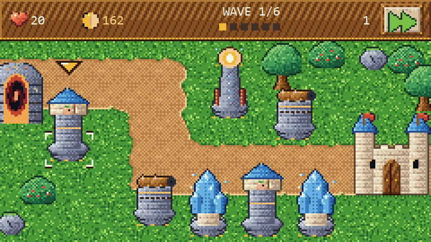</p>

A tower defense with **12 levels in 4 worlds** (Meadow, Desert, Snow, Volcano) and rising difficulty.

| | |
|---|---|
| 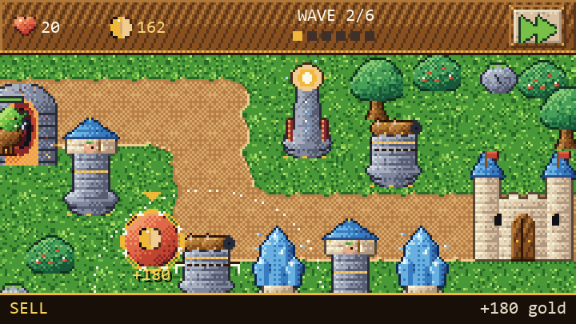 | 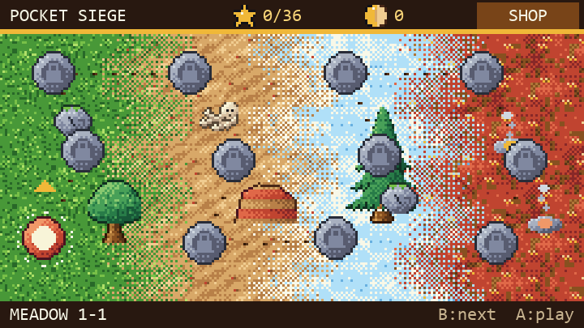 |

- 4 towers with 3 levels each: Archer (critical hits), Cannon (splash), Frost (slows), Storm (chain lightning)
- 6 enemies including flyers, a healing shaman and the Ogre King boss at the end of each world
- Radial build menu, coins and damage numbers, x2 speed
- 1 to 3 stars per level, coins buy permanent upgrades in the Shop (damage, range, starting gold, lives, fire rate)
- B = next spot, A = build / upgrade / sell, PWR = pause

## New in v1.9: Ember Pinball

<p align="center">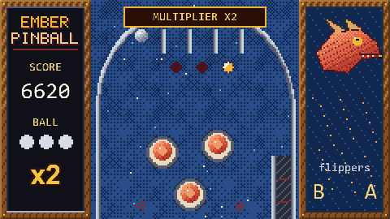</p>

An original pinball table that scrolls with the ball: 3 pop bumpers, 2 slingshots, drop targets, 3 top lanes that raise the multiplier up to x5, a kick-out saucer and ball save. **B** = left flipper, **A** = right flipper, hold **A** to launch harder, shake the console to nudge (too much = TILT).

## Games

| | | |
|---|---|---|
| 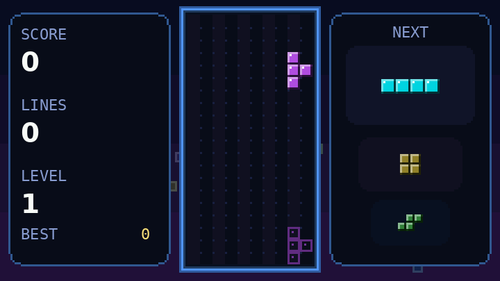 **Tetris** | 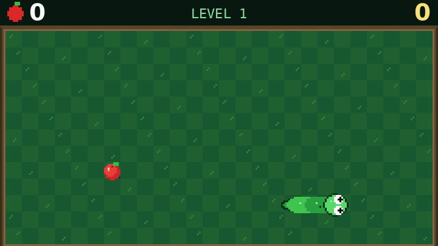 **Snake** |  **Lunar Lander** |
|  **Flap Bird** |  **Racing** |  **Flight** |
| 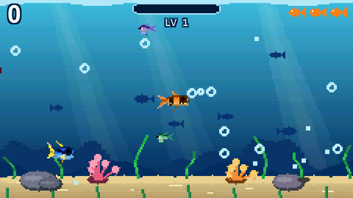 **Fish** |  **River** | 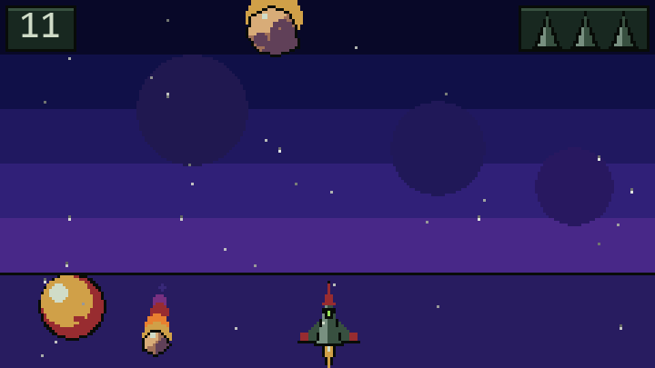 **Meteors** |
| 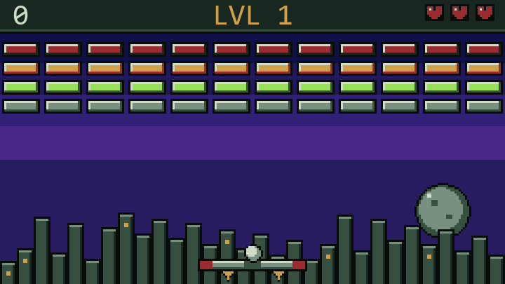 **Breakout** | 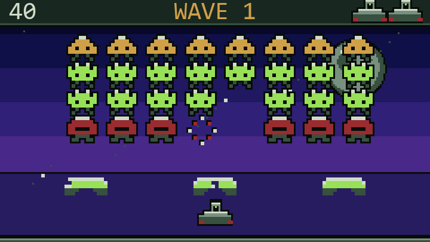 **Invaders** |  **Emberwood** |
|  **Pocket Siege** | 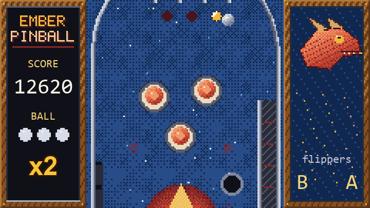 **Ember Pinball** | |

Also included: **Chrome Dino, Maze, Slalom, Stack**.

| | | |
|---|---|---|
| 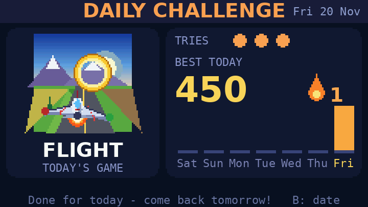 **Daily Challenge** | 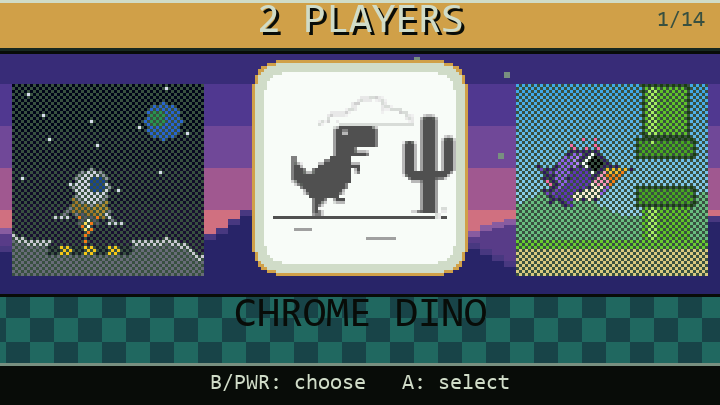 **2 Players** | 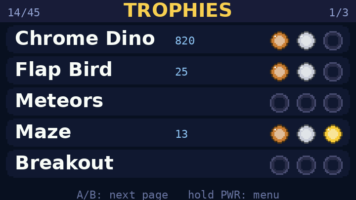 **Trophies** |
| 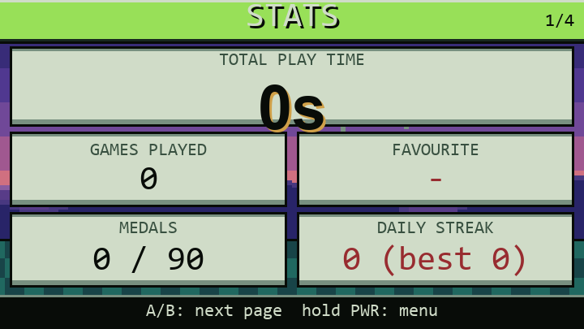 **Stats** | 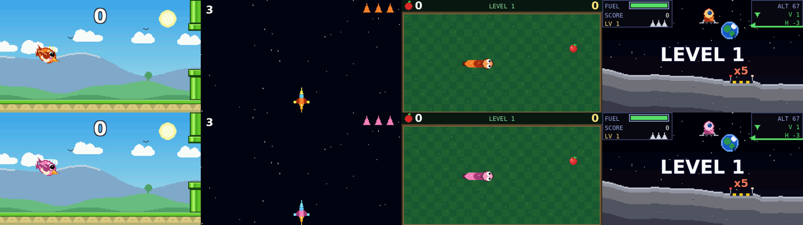 **Skins** | 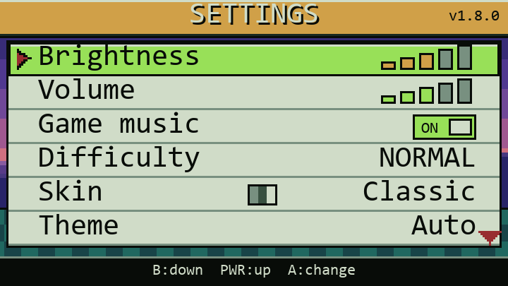 **Settings** |

## Features

- **Tilt controls** with the built-in motion sensor. It detects whether you hold the stick flat or upright and adapts
- **Tilt or buttons** in Tetris and Snake: a screen asks before the game, or set it once in Settings > Controls

  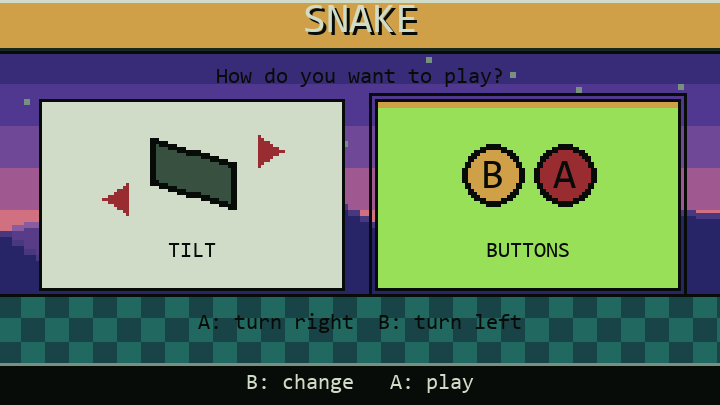
- **Medals** (bronze, silver, gold) for every game, on Normal and Hard
- **Daily Challenge** (one game and one seed per day, 3 tries, streak) and **2 Players** (pass and play)
- **Stats**: play time, games played, favourite game
- **Skins** for the heroes, unlocked with medals
- **Difficulty**: Easy (practice), Normal, Hard
- Original chiptune music in every game, plus a **music player** with 25 public domain tunes
- **Settings**: brightness, volume, game music, controls, screen rotation (normal / flipped), difficulty, skin, menu theme, sleep time, tilt calibration, language, date and time
- First-boot setup: language, tilt calibration, date and time
- English and French

## Controls

| Button | Action |
|---|---|
| **A** | Select / main action |
| **B** | Secondary action / next |
| **PWR** | Pause (previous item in the menu) |
| **Hold PWR 1.5 s** or **hold A + B 1.2 s** | Back to the menu |
| **Tilt** | Steer in the games that use it |

Buttons mode: **Tetris** B = left, A = right, PWR = rotate, hold A+B = drop. **Snake** A = turn right, B = turn left.

**Cardputer keys:** Enter / Space (or the Go button) = A, Tab or Ctrl = B, Del or `` ` `` = PWR, `,` `/` `;` `.` = tilt on models without a motion sensor.

If tilting feels wrong, recalibrate in **Settings > Calibrate**.

## Supported devices

| Device | File | Status |
|---|---|---|
| M5StickC Plus2 | `AD-Arcade-M5StickCPlus2-v1.9.0.bin` | main device, tested |
| M5StickC Plus | `AD-Arcade-M5StickCPlus-v1.9.0.bin` | community testing needed |
| M5StickS3 | `AD-Arcade-M5StickS3-v1.9.0.bin` | earlier versions confirmed working by a tester |
| M5Cardputer / Cardputer-ADV | `AD-Arcade-M5Cardputer-v1.9.0.bin` | community testing needed |

## Install

**Easiest:** open [M5Burner](https://burner.m5stack.com/SKKL8X), pick AD Arcade and click Burn.

**Manual:** download the `.bin` for your device from the [Releases](../../releases) page and flash it at address `0x0`:

```
esptool.py --chip esp32 --port <your port> write_flash 0x0 AD-Arcade-M5StickCPlus2-v1.9.0.bin
```
for example, port `COM3`. Use `--chip esp32s3` for the StickS3 and the Cardputer.

## Build from source

Requires [PlatformIO](https://platformio.org/).

```
pio run -e m5stickc-plus2      # or m5stickc-plus, m5sticks3, m5cardputer
```

The result is a single image in the project root (for example `AD-Arcade-M5StickCPlus2.bin`) to flash at `0x0`. StickC builds use M5Unified 0.2.7 / M5GFX 0.2.9, StickS3 and Cardputer builds use M5Unified / M5GFX 0.3.0.

The pixel art of Emberwood is generated by the Python scripts in `tools/art` (`python export_zelda.py` writes `src/zelda_art.h`). `tools/hs` contains a PC test harness.

## Feedback

Found a bug or have an idea for a new game? Open an [issue](../../issues). I can only test on my own M5StickC Plus2, so reports from other devices are very welcome.

## License

AD Arcade is **free to use but not open source**: you can flash it, use it and share the unmodified firmware for free with credit, but you cannot sell it or publish modified copies. See [LICENSE](LICENSE) for the full terms. The tunes in the music player are public domain, and the games, art and music loops are original. The Cardputer keyboard library in `vendor/M5Cardputer` is © M5Stack, MIT license.
