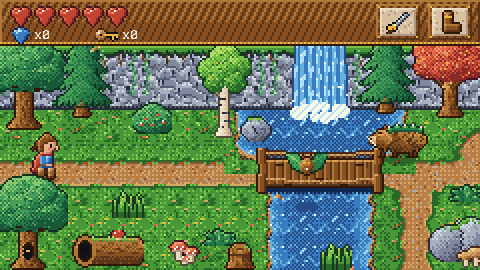

# AD Arcade v1.8.0 (beta)

**New game: Legend of Emberwood**, a top-down pixel-art adventure with an original hero, Kiri.



- 10 screens: the village (merchant, blacksmith, old Magda, Pip and the gate guard), the forest (river, waterfall, bridge, clearing, ruins), the torch-lit crypt and the volcanic arena of the **Ember Golem**.
- Boss in 3 phases: ground slam with shockwave, fire eruptions, then flaming boulders and orbiting rock shards.
- Tilt to walk, **A** = sword / talk / open, **B** = roll (dodge), **PWR** = pause. Hold PWR (or A + B) to go back to the menu.
- Hearts, gems, keys, chests, breakable urns, cuttable tall grass, day/night cycle with fireflies, dynamic torch lighting in the crypt.
- Auto-save: Continue or New game from the title screen.
- Hand-made 48-colour pixel art (animated hero, 6 enemies with particle deaths, articulated golem), stored as compact 4-bit / RLE data.

Also in this release: everything from v1.6 to v1.7.3 (new retro look, first-boot wizard with date and time, Skins screen, restyled menu and screens, colourful backgrounds, new Meteors). See [CHANGELOG.md](CHANGELOG.md).

## Downloads (flash at address 0x0)

| Device | File | Status |
|---|---|---|
| M5StickC Plus2 | `AD-Arcade-M5StickCPlus2-v1.8.0.bin` | played on a real device |
| M5StickC Plus | `AD-Arcade-M5StickCPlus-v1.8.0.bin` | community testing needed |
| M5StickS3 | `AD-Arcade-M5StickS3-v1.8.0.bin` | community testing needed (older versions confirmed working) |
| M5Cardputer | `AD-Arcade-M5Cardputer-v1.8.0.bin` | community testing needed |

```
python -m esptool --chip esp32 --port COMx write_flash 0x0 AD-Arcade-M5StickCPlus2-v1.8.0.bin
```
(use `--chip esp32s3` for the StickS3 and the Cardputer)

If tilting feels wrong, recalibrate in **Settings**. Please report how it runs on your device in the Issues tab.
