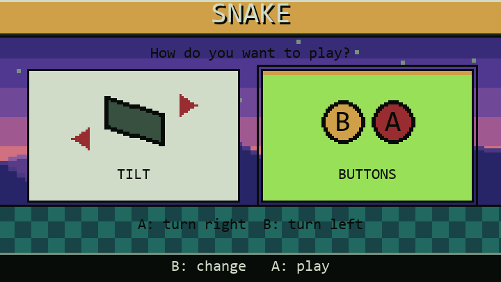

# AD Arcade v1.8.1 (beta)



- **Tilt or buttons**: Meteors, Breakout, Invaders, Slalom, Racing, River, Tetris, Snake and Lunar Lander can be played with the buttons. A screen asks before the game (the choice is remembered), or set it once in Settings > Controls (Ask / Tilt / Buttons).
  - B = left, A = right. Racing: A+B = nitro. Invaders: auto fire. Tetris: A+B = rotate, hold A+B = drop. Snake: A/B = turn. Lunar Lander: A/B = rotate, A+B = thrust.
- **Screen rotation**: Settings > Screen (Normal / Flipped 180 degrees). Tilt follows the screen.
- **Legend of Emberwood**: original background music (village & forest, crypt, boss), medals and a final score (bronze for beating the Ember Golem, silver and gold for fast runs), now listed in Trophies and Stats. Fixed getting stuck in a tree at the forest clearing and not being able to leave the village.
- **Cardputer / Cardputer-ADV**: the screen was rotated 90 degrees (now landscape), Enter/Space now work as A (the language screen could not be validated before), Ctrl also works as B. Thanks to the Reddit tester!

## Downloads (flash at address 0x0)

| Device | File | Status |
|---|---|---|
| M5StickC Plus2 | `AD-Arcade-M5StickCPlus2-v1.8.1.bin` | played on a real device |
| M5StickC Plus | `AD-Arcade-M5StickCPlus-v1.8.1.bin` | community testing needed |
| M5StickS3 | `AD-Arcade-M5StickS3-v1.8.1.bin` | community testing needed |
| M5Cardputer / ADV | `AD-Arcade-M5Cardputer-v1.8.1.bin` | community testing needed (fixes from an ADV user report) |

```
python -m esptool --chip esp32 --port COMx write_flash 0x0 AD-Arcade-M5StickCPlus2-v1.8.1.bin
```
(use `--chip esp32s3` for the StickS3 and the Cardputer)
