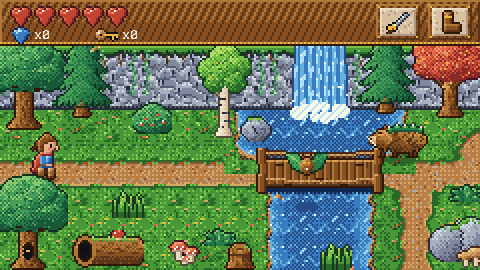

# AD Arcade v1.8.2

The v1.8 update: **Legend of Emberwood**, a full pixel-art adventure with a 3-phase boss, plus everything since v1.5.



## Highlights since v1.5
- **New game: Legend of Emberwood** (village, forest, crypt, Ember Golem boss), with original music, medals and auto-save
- **Tilt or buttons** in Tetris and Snake (Settings > Controls). Tetris: B = left, A = right, PWR = rotate, hold A+B = drop
- **Screen rotation**: Settings > Screen (normal / flipped)
- New retro look, first-boot setup (language, calibration, date and time), Skins screen, restyled menu and screens
- Builds for the **M5StickC Plus, M5StickS3 and M5Cardputer / Cardputer-ADV** (landscape screen and keyboard fixes)

## Changes in v1.8.2
- Buttons mode is now only offered in Tetris and Snake
- Tetris with buttons: PWR rotates (no pause in this mode), hold A+B to drop; A+B no longer rotates by accident

Full list: [CHANGELOG.md](CHANGELOG.md)

## Downloads (flash at address 0x0)

| Device | File | Status |
|---|---|---|
| M5StickC Plus2 | `AD-Arcade-M5StickCPlus2-v1.8.2.bin` | tested |
| M5StickC Plus | `AD-Arcade-M5StickCPlus-v1.8.2.bin` | community testing needed |
| M5StickS3 | `AD-Arcade-M5StickS3-v1.8.2.bin` | community testing needed |
| M5Cardputer / ADV | `AD-Arcade-M5Cardputer-v1.8.2.bin` | community testing needed |

```
esptool.py --chip esp32 --port COMx write_flash 0x0 AD-Arcade-M5StickCPlus2-v1.8.2.bin
```
(use `--chip esp32s3` for the StickS3 and the Cardputer)
