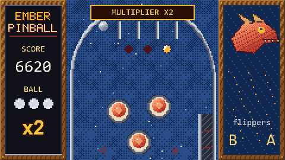

# AD Arcade v1.9.0

Two new games, new menu icons and many small fixes. **18 games** in total.



## New games
- **Ember Pinball**: an original pinball table that scrolls with the ball. 3 pop bumpers, 2 slingshots, drop targets (+2500 bonus), 3 top lanes that raise the multiplier up to x5 (the flippers move the lit lanes), a kick-out saucer, ball save and nudging. B = left flipper, A = right flipper, hold A to launch harder.
- **Pocket Siege**: a tower defense with 12 levels in 4 worlds (Meadow, Desert, Snow, Volcano). 4 towers with 3 levels each, 6 enemies including the Ogre King boss, 1 to 3 stars per level and a Shop of permanent upgrades bought with coins.

## Improvements
- New menu icons: the game icons now show real pixels from each game, the apps have new bold symbols
- The FLAT/UPRIGHT message no longer covers the game icon
- Stack and Slalom title screens fixed
- Everything from v1.8 (Legend of Emberwood, tilt or buttons in Tetris and Snake, screen rotation, Cardputer fixes)

## Downloads (flash at address 0x0)

| Device | File | Status |
|---|---|---|
| M5StickC Plus2 | `AD-Arcade-M5StickCPlus2-v1.9.0.bin` | tested |
| M5StickC Plus | `AD-Arcade-M5StickCPlus-v1.9.0.bin` | community testing needed |
| M5StickS3 | `AD-Arcade-M5StickS3-v1.9.0.bin` | community testing needed |
| M5Cardputer / ADV | `AD-Arcade-M5Cardputer-v1.9.0.bin` | community testing needed |

```
esptool.py --chip esp32 --port COMx write_flash 0x0 AD-Arcade-M5StickCPlus2-v1.9.0.bin
```
(use `--chip esp32s3` for the StickS3 and the Cardputer)

Full list: [CHANGELOG.md](CHANGELOG.md)
